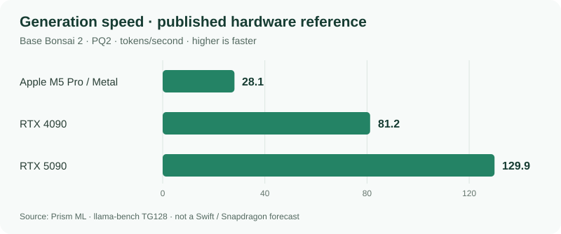
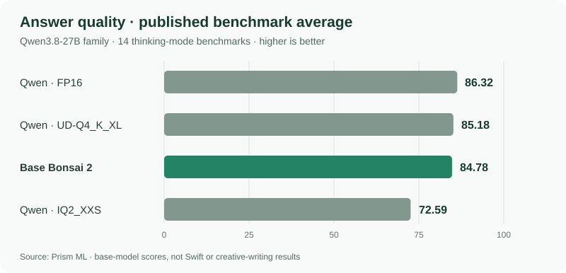

# 🌱 Swift Bonsai 2 - Runner

**A local runner for the Swift Bonsai 2 model on Windows ARM64.**

Creative writing · Brainstorming · Art direction

[Get started](docs/development-guide.md) · [Documentation](#documentation) · [TODO](PLAN.md)

---

Swift Bonsai 2 is a language model by [UkisAI](https://ukisai.com/swift-bonsai-2),
built on [PrismML's Bonsai 2](https://huggingface.co/prism-ml/Ternary-Bonsai-2-27B-gguf),
which derives from [Alibaba's Qwen3.8-27B](https://huggingface.co/Qwen/Qwen3.8-27B).

This project provides a local creative assistant for **Windows ARM64 laptops
with Snapdragon X and X2 processors**. It currently runs on the CPU, with
[automatic hardware tuning and GPU/NPU support](docs/hardware-profiles.md)
planned.

The native Rust engine lives in [Prism Inference](https://github.com/symbiogenesis/prism-inference).
This project consumes a pinned prebuilt server; ordinary builds do not compile
the inference engine. Provision it with `./scripts/Get-Inference.ps1 -DataDirectory <absolute-path>`.

For a source checkout, run `git submodule update --init third_party/simd-json`
before building or using the launcher to initialize the pinned dependency source.

Once you've [set up the model and runtime](docs/development-guide.md#native-chat-app),
run `./scripts/Start-Chat.ps1` to open the native Windows chat app.

Keep separate conversations and unsent drafts, rename your chats, and find text
with **Ctrl+F**. Enable **Save conversations on this device** in Settings to
recover your workspace after closing; saved conversations use Windows user
encryption. Saving is off by default.

Thinking is off by default. Enable **Thinking** under **Settings → Response**
for the next response, including every Extra effort pass. Each conversation
keeps its own choice; optional conversation saving restores it.

Settings also adjusts the pinned abliteration adapter's strength for the next
response. The default scale is **1.3**; **0** disables its correction. Its effect
and output quality on Swift remain experimental.

You can chat with Swift, hear answers read aloud in a voice you describe, or
dictate a message to review before sending. The microphone stays off until you
turn it on and grant Windows permission. **Read aloud as responses arrive** reads
new answers while Swift writes; each response's speaker button remains available
for independent replay.

The launcher downloads speech models automatically. The setup guide explains
how to skip those downloads or preview the app without loading a model.
For developer details, see the [native Rust UI architecture](docs/ui-architecture.md)
and [local API contract](docs/broker-policy.md#public-request-contract).

## At a glance

| | Current target |
| --- | --- |
| **Hardware** | Snapdragon X and X2 · Windows ARM64 |
| **Model** | Swift Bonsai 2 · `PQ2_0` |
| **CPU profile** | One active request · 8K-token context · FP16 attention caches |
| **Outstanding work** | [Central TODO](PLAN.md) |

## Memory footprint

| Model | Model file | Development budget | Free RAM to start |
| --- | ---: | ---: | ---: |
| **Swift Bonsai 2 `PQ2_0`** | **6.71 GiB** | **12 GiB** | **16 GiB** |
| Qwen3.8-27B `UD-Q3_K_XL` | 12.24 GiB | 18 GiB | 22 GiB |

Swift's pinned model file is **about 45% smaller** than the Qwen reference. The
budgets above are configured development allowances, not measured peak usage.

> [!NOTE]
> Startup requires **currently available physical RAM**, including a 4 GiB safety
> reserve. A machine with 16 GB installed does not meet the current Swift
> requirement. Longer conversations, caching, and other applications need
> additional headroom.

See the [Swift memory assessment](docs/swift-memory.md) and
[Qwen reference accounting](docs/model-selection.md#source-only-compatibility-and-memory-sanity-check).

## Performance expectations

### Response speed

Compact weights can reduce memory traffic, but response speed also depends on
the hardware, runtime and prompt length. **Swift's Snapdragon tokens/second have
not been measured yet.** For context, these are Prism's published results for
the **base Bonsai 2 model**, using PQ2 weights on other hardware:

[Source: Prism throughput benchmarks](https://huggingface.co/prism-ml/Ternary-Bonsai-2-27B-gguf#cross-platform-throughput).
These are reference points, not a Swift or Snapdragon speed forecast. Thinking
time and long prompts also affect how soon a useful answer arrives.

### Answer quality

Prism reports **84.78** for base Bonsai 2 versus **86.32** for full-precision
Qwen3.8-27B across 14 thinking-mode benchmarks. The chart shows how that compares
with conventional compressed versions of the same Qwen base:

[Source: Prism benchmark results](https://huggingface.co/prism-ml/Ternary-Bonsai-2-27B-gguf#benchmarks).
These scores cover **base Bonsai, not Swift**, and do not measure creative-writing
quality. Swift's own publisher reports [uneven general-purpose behavior](https://ukisai.com/swift-bonsai-2#research-status-and-limitations).
Creative-writing quality and daily-service isolation still need qualification.
See [benchmark context and current limits](docs/performance-expectations.md).

## Documentation

### Start here

| Guide | What you'll find |
| --- | --- |
| [Development guide](docs/development-guide.md) | Requirements, setup, and development commands |
| [Validation](docs/validation.md) | Code standards, focused tests, and CI |
| [TODO](PLAN.md) | All outstanding implementation and qualification work |

### Runtime and acceleration

| Guide | What you'll find |
| --- | --- |
| [Automatic X1/X2 configuration](docs/hardware-profiles.md) | Capability, profile selection, phase placement and fallback contracts |
| [Prism Inference](https://github.com/symbiogenesis/prism-inference) | Independent Rust runtime, published crates and prebuilt server binaries |
| [CPU SIMD contracts](docs/simd-plan.md) | Packed NEON kernels, numerical contracts, safe dispatch, and qualification |
| [Adreno GPU contracts](docs/adreno-gpu-plan.md) | Vulkan placement, arithmetic and device qualification boundaries |
| [Hexagon NPU contracts](docs/hexagon-npu-plan.md) | Signed runtime access, exact Swift kernels/state, placement, and qualification |

### Research

| Guide | What you'll find |
| --- | --- |
| [Model and memory research](docs/swift-memory.md) | The current Swift assessment and experiments |
| [Inference algorithms](docs/inference-algorithms.md) | LUT/prefill/cache opportunities, mathematical limits, and experimental boundaries |
| [Implementation decisions](docs/implementation-research.md) | Design rationale and evidence limits |
| [Inference defaults](docs/inference-defaults.md) | Sampling, thinking, prompt/harness and cache choices backed by published evidence |

---

## License

Original project code, documentation, and configuration are licensed under the
[Apache License 2.0](LICENSE). Third-party code retains its own terms, including
the MIT-licensed Prism/ggml portions identified in [NOTICE](NOTICE).

Model weights and adapters are separate downloads governed by their publishers'
licenses. See the [license decision and dependency review](docs/licensing.md)
for scope, attribution, and redistribution requirements.
